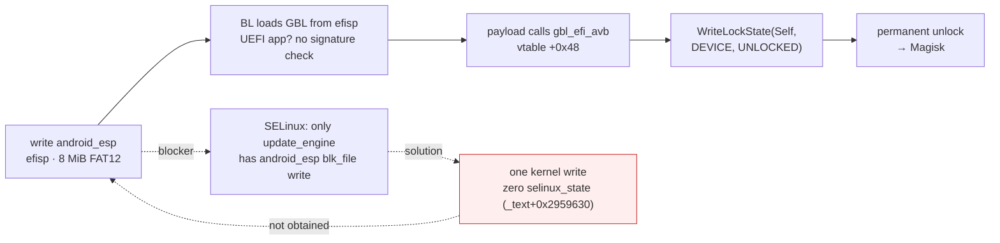

# lhasa-research

Boot-chain and kernel security research on the **Xiaomi 18 Fold** (codename `lhasa`, XRing O3 SoC,
Android 17 / HyperOS, kernel `6.18.21-android17-5`, SPL 2026-08-01, bootloader locked).
Research perspective: `adb shell` — uid 2000, no capabilities, SELinux enforcing.

The repository contains three bodies of work:

1. **Bootloader unlock chain** — verified end to end except the final step; the UEFI unlock payload
   (2,560 bytes) and the ESP image patcher are ready. The chain depends on a kernel write primitive
   that has not been obtained.
2. **Kernel patch-level audit** — the device's kernel is checked against upstream stable fixes:
   its effective stable level is **6.18.44**, and 14 fixes from 6.18.45 onward that are reachable
   by uid 2000 have not been backported.
3. **Attack-surface audit** — 11 candidate surfaces ruled out, each with instruction-level evidence.

One-page overview: [docs/SUMMARY.md](docs/SUMMARY.md). Narrative journal:
[docs/journal/EN-JOURNAL.md](docs/journal/EN-JOURNAL.md). 中文说明：[README.md](README.md).

## The unlock chain

The device loads its bootloader (GBL) from the `android_esp` partition — XRing's equivalent of
Qualcomm's `efisp`: an 8 MiB FAT12 volume. Its `EFI/BOOT/BOOTAA64.EFI` (1.58 MB) carries no
Authenticode signature and the partition has no AVB footer; the loader only checks that the file is
a valid UEFI application.

GBL implements the `gbl_efi_avb` protocol (AOSP `platform/bootable/libbootloader`, branch
`gbl-android17`), GUID `{6bc66b9a-d5c9-4c02-9da9-50af198d912c}`, with
`WriteLockState(Self, Type, State)` at vtable `+0x48`. In the source, `flashing unlock` performs no
further check for `LockType::Device` — this method is the only arbiter of the lock state.



## Unlock payload

`payload/esp_unlock.c`:

```sh
zig cc -target aarch64-uefi -O2 -o BOOTAA64_unlock.EFI payload/esp_unlock.c
```

The result is 2,560 bytes (PE32+, machine 0xAA64, subsystem 10, no `.reloc`, position independent).
`tools/esp_patch.py` writes it into the ESP image in place of the original `BOOTAA64.EFI`
(only the FAT12 directory-entry size field changes; verified byte-for-byte).

## Patch-level audit

Method: 38 upstream ChangeLogs (6.18.23–6.18.58, 12,142 commit subjects) are filtered to 46 entries
by "subsystem reachable by uid 2000 AND memory-corruption shape". For each, the fix diff is pulled
from git.kernel.org, an assembly-level fingerprint is derived (a new comparison, a new bounds
branch, a field-offset usage), and the fingerprint is checked instruction by instruction in
`vmlinux-4.0.21.0.elf`.

Result (21 fully checked): **14 missing · 1 present (equivalent implementation) · 6 not compiled**.
Calibration anchors: the 6.18.39 binder `tmp_ref` pin is present (`0x1c5b8c`, `0x1c5ba8 stadd`),
and the 6.18.44 hid-logitech-dj `report_count == 14` check is present (`0xf7fb80 cmp w3,#0xe`),
so the effective level brackets to 6.18.44, with no out-of-order backports from later releases.

Two of the missing entries are UAFs reachable with plain syscalls (the futex private-hash refcount
race and the futex/pi `exec()` race). Triggers for the latter were built and run for 256,000
iterations (20,000 + 20,000 + 166,000 + 50,000) with no observable effect; with `kasan=off`, no
readable kernel log, and `panic_on_warn=0`, blind triggering cannot confirm a hit. The full verdict
table and trigger records are in `docs/patch-level/`.

## Attack-surface audit

| # | Surface | Verdict | Report |
|---|---|---|---|
| 1 | CVE-2026-64560 (posix-cpu-timers non-leader exec UAF) | Mechanically unreachable: `de_thread` does `exchange_tids` + `transfer_pid(TGID)` before `release_task`, so the `!sh` window never exists; 17,600 execs, zero hits | [64560_DEAD_ON_LHASA.md](docs/audits/64560_DEAD_ON_LHASA.md) |
| 2 | hid-multitouch (missing report-ID validation) | Stopped by the core `-EINVAL` guard | [HID_MT_C1_RECHECK.md](docs/audits/HID_MT_C1_RECHECK.md) |
| 3 | uinput force-feedback UAF | `/dev/input/event*` is EACCES for shell; cannot be triggered | [UINPUT_FF_AUDIT.md](docs/audits/UINPUT_FF_AUDIT.md) |
| 4 | uinput non-FF ioctls | No OOB/UAF (name forced NUL-terminated; 11 `*_MAX` bounds) | [UINPUT_ASHMEM_AUDIT.md](docs/audits/UINPUT_ASHMEM_AUDIT.md) |
| 5 | Xiaomi ashmem variants | No memory corruption (side finding: `ignore_unset_prot_exec` gives uid 2000 executable anonymous memory) | same |
| 6 | tango32 (vendor misc driver) | No objects, no OOB; compat_ioctl forwarding does not change the SELinux verdict | [TANGO32_AUDIT.md](docs/audits/TANGO32_AUDIT.md) |
| 7 | mali0 (kbase, 1.9 MB) | Every ioctl EPERM (shell not in the allow domain) | [probes/l71_mali.c](probes/l71_mali.c) |
| 8 | xr_fbt | Provider module not in any extractable partition (`os_cpu_qi.ko` only imports `register_xr_fbt`) | [MODULE_PIPELINE.md](docs/patch-level/MODULE_PIPELINE.md) |
| 9 | binder page allocator | Real defect, DoS only (write target is a constant unmapped address; a hit always panics) | [BINDER_ALLOC_AUDIT.md](docs/audits/BINDER_ALLOC_AUDIT.md) |
| 10 | binder transaction path and fd transfer | Structurally clean (no TOCTOU on offsets, four bounds checks, no double-close/OOB on fds) | [BINDER_TXN_AUDIT.md](docs/audits/BINDER_TXN_AUDIT.md) · [BINDER_FD_AUDIT.md](docs/audits/BINDER_FD_AUDIT.md) |
| 11 | pty/tty | All ring-buffer writes carry `and 0xfff`; ldisc switch holds the write lock; `tty_struct` is a dedicated cache | [TTY_AUDIT.md](docs/audits/TTY_AUDIT.md) |

Erratum: an earlier conclusion — "the binder write path requires the buffer to lie inside its own
VMA" — was a measurement artefact: the probe sent the bare command word `0x0c` while the kernel
compares the ioctl-encoded value `0x0000630c`. With the correct encoding, `BC_TRANSACTION` reports
`write_consumed=68`. See [BINDER_REOPENED.md](docs/audits/BINDER_REOPENED.md).

## Tools

Dependencies: Python (`capstone`, `pyelftools`, `lz4`, `zstandard`), zig 0.13 (payload).

| Tool | Purpose |
|---|---|
| `tools/ota_extract.py` | Single-partition OTA fetch over HTTP ranges (CDN requires a browser UA + Referer) |
| `tools/ota_head.py` | Fetch only the first N bytes of a partition (EROFS metadata head) |
| `tools/erofs_extract.py` | EROFS reader (legacy/compact, LZ4/ZSTD, datalayout 1/3, big-pcluster, tail-packing) |
| `tools/dump_one.py` | Export a single file by path substring |
| `tools/kdisasm.py` | Symbol-based disassembly of the device kernel (vmlinux + Image) |
| `tools/ko_disasm.py` | Symbol-based disassembly of ET_REL modules with branch annotation |
| `tools/btf_dump.py` | Exact structure layouts from `.BTF` |
| `tools/esp_patch.py` | Replace `EFI/BOOT/BOOTAA64.EFI` inside the FAT12 ESP image |
| `tools/fat_*.py` | FAT12 list/extract/walk |
| `tools/solve_live.py` + `cap_pair.sh` | KASLR slide from the trace ring buffer (11 symbols cross-checked, spread = 0) |
| `tools/analyze_sepolicy.py` | SELinux CIL policy analysis (handles versioned type names and base_typeattr) |
| `probes/*.c` | 42 on-device probes (surface mapping, ioctl oracles, race triggers, sanity checks) |
| `patches/*.patch` | Upstream fix patches (GPL-2.0, for comparison) |

The module pipeline (OTA → EROFS → 486 vendor `.ko` files, all extracted and verified) is described
in [MODULE_PIPELINE.md](docs/patch-level/MODULE_PIPELINE.md).

## Layout

```
docs/SUMMARY.md      one-page overview
docs/journal/        handover documents and stage reports; EN-JOURNAL.md is the English narrative
docs/audits/         attack-surface audits (each conclusion cites instruction addresses)
docs/patch-level/    patch-level audit, futex candidates and trigger records, module pipeline
tools/               analysis and packaging tools
probes/              on-device probe sources
payload/             unlock payload source
patches/             upstream patch files
```

## License and scope

Code in this repository is released under MIT (see [LICENSE](LICENSE)). Files under `patches/` are
upstream Linux stable patches (GPL-2.0, from kernel.org), included for audit comparison only.

All work was done on a device we own, after a full backup. The repository contains no vendor
firmware, module binaries, OTA packages, signing keys, or device dumps. It does not contain a
working privilege-escalation exploit: the unlock payload depends on a kernel write primitive that
has not been obtained, and the race triggers exist only to verify whether a fix is missing.
