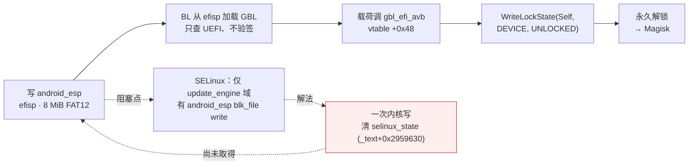

# lhasa-research

Xiaomi 18 Fold（codename `lhasa`，XRing O3 SoC，Android 17 / HyperOS，kernel `6.18.21-android17-5`，SPL 2026-08-01，bootloader 锁定）的引导链与内核安全研究。研究视角为 `adb shell`：uid 2000、无 capability、SELinux Enforcing。

仓库包含三部分内容：

1. **Bootloader 解锁链**：已验证到最后一步，UEFI 解锁载荷（2,560 字节）与 ESP 镜像打包工具就绪；链路依赖一个内核写原语，目前未取得。
2. **内核补丁级别审计**：用上游 stable 修复清单反查设备内核，有效补丁级别为 **6.18.44**；6.18.45 起有 14 条 uid 2000 可达的安全修复未回移。
3. **攻击面审计**：11 个候选攻击面逐一排除，结论均附指令级证据。

一页式概览见 [docs/SUMMARY.md](docs/SUMMARY.md)；英文版见 [README.en.md](README.en.md) 与 [docs/journal/EN-JOURNAL.md](docs/journal/EN-JOURNAL.md)。

## 解锁链

设备从 `android_esp` 分区（XRing 平台的 efisp 实现，8 MiB FAT12）加载引导程序 GBL。镜像内 `EFI/BOOT/BOOTAA64.EFI`（1.58 MB）无 Authenticode 签名，分区无 AVB footer，加载时仅校验其是否为合法 UEFI 应用。

GBL 实现 `gbl_efi_avb` 协议（AOSP `platform/bootable/libbootloader`，分支 `gbl-android17`），GUID `{6bc66b9a-d5c9-4c02-9da9-50af198d912c}`，vtable `+0x48` 为 `WriteLockState(Self, Type, State)`。源码中 `flashing unlock` 对 `LockType::Device` 不做二次校验，该方法即锁定状态的唯一裁决点。



## 解锁载荷

`payload/esp_unlock.c`：

```sh
zig cc -target aarch64-uefi -O2 -o BOOTAA64_unlock.EFI payload/esp_unlock.c
```

产物 2,560 字节（PE32+，machine 0xAA64，subsystem 10，无 `.reloc`，地址无关）。
`tools/esp_patch.py` 将其原地写入 ESP 镜像的 `EFI/BOOT/BOOTAA64.EFI`（仅更新 FAT12 目录项的 size 字段，已逐字节验证）。

## 补丁级别审计

方法：取 36 份上游 ChangeLog（6.18.23–6.18.58，共 12,142 条提交主题），按"uid 2000 可达子系统 + 内存破坏形状"过滤至 46 条；逐条从 git.kernel.org 取修复 diff，提取汇编级指纹（新增比较指令、边界分支、字段偏移用法），在 `vmlinux-4.0.21.0.elf` 中逐一核对。

结果（21 条完整核对）：**未修 14 · 已修 1（等效实现）· 未编译 6**。校准锚点：6.18.39 的 binder `tmp_ref` pin 存在（`0x1c5b8c`、`0x1c5ba8 stadd`），6.18.44 的 hid-logitech-dj `report_count==14` 检查存在（`0xf7fb80 cmp w3,#0xe`），故有效级别夹逼为 6.18.44，且 6.18.45 起无越级单独回移。

未修条目中含两个纯 syscall 可达的 UAF（futex 私有哈希 ref 计数竞态、futex/pi exec() 竞态）。已为后者编写触发器并运行 256,000 次迭代（20,000 + 20,000 + 166,000 + 50,000），无可观察效果；`kasan=off`、内核日志不可读、`panic_on_warn=0`，盲触发无法确认命中。完整判定表与触发记录见 `docs/patch-level/`。

## 攻击面审计

| # | 面 | 结论 | 报告 |
|---|---|---|---|
| 1 | CVE-2026-64560（posix-cpu-timers 非 leader exec UAF） | 机制级不可达：`de_thread` 先 `exchange_tids`+`transfer_pid(TGID)` 再 `release_task`，`!sh` 窗口不存在；17,600 次 exec 零命中 | [64560_DEAD_ON_LHASA.md](docs/audits/64560_DEAD_ON_LHASA.md) |
| 2 | hid-multitouch（report-ID 校验缺失） | 被核心 `-EINVAL` 守卫拦截 | [HID_MT_C1_RECHECK.md](docs/audits/HID_MT_C1_RECHECK.md) |
| 3 | uinput force-feedback UAF | `/dev/input/event*` 对 shell EACCES，不可触发 | [UINPUT_FF_AUDIT.md](docs/audits/UINPUT_FF_AUDIT.md) |
| 4 | uinput 非 FF ioctl | 无 OOB/UAF（name 强制 NUL 结尾、11 处 `*_MAX` 界） | [UINPUT_ASHMEM_AUDIT.md](docs/audits/UINPUT_ASHMEM_AUDIT.md) |
| 5 | ashmem 小米变体 | 无内存破坏（附带发现：`ignore_unset_prot_exec` 可使 uid 2000 获得可执行匿名内存） | 同上 |
| 6 | tango32（厂商 misc 驱动） | 无对象、无 OOB；compat_ioctl 转发不改变 SELinux 判决 | [TANGO32_AUDIT.md](docs/audits/TANGO32_AUDIT.md) |
| 7 | mali0（kbase，1.9 MB） | ioctl 全部 EPERM（allow 域不含 shell） | [probes/l71_mali.c](probes/l71_mali.c) |
| 8 | xr_fbt | 驱动提供方模块不在可取分区（`os_cpu_qi.ko` 仅 import `register_xr_fbt`） | [MODULE_PIPELINE.md](docs/patch-level/MODULE_PIPELINE.md) |
| 9 | binder 页面分配器 | 缺陷成立，仅 DoS（写落点常量非映射，命中必 panic） | [BINDER_ALLOC_AUDIT.md](docs/audits/BINDER_ALLOC_AUDIT.md) |
| 10 | binder 事务路径与 fd 传递 | 结构性干净（offsets 无 TOCTOU、四道界、fd 无 double-close/OOB） | [BINDER_TXN_AUDIT.md](docs/audits/BINDER_TXN_AUDIT.md) · [BINDER_FD_AUDIT.md](docs/audits/BINDER_FD_AUDIT.md) |
| 11 | pty/tty | 环缓冲写点全部 `and 0xfff` 越界保护；ldisc 切换持写锁；`tty_struct` 为专用 cache | [TTY_AUDIT.md](docs/audits/TTY_AUDIT.md) |

勘误：早期结论"binder 写路径要求缓冲位于自身 VMA 内"为测量伪影——探测程序发送了裸命令字 `0x0c`，而内核比对的是 ioctl 编码值 `0x0000630c`。修正后 `BC_TRANSACTION` 实测 `write_consumed=68`。见 [BINDER_REOPENED.md](docs/audits/BINDER_REOPENED.md)。

## 工具

依赖：Python（`capstone`、`pyelftools`、`lz4`、`zstandard`）、zig 0.13（载荷编译）。

| 工具 | 用途 |
|---|---|
| `tools/ota_extract.py` | OTA 单分区 HTTP Range 抠取（CDN 需浏览器 UA + Referer） |
| `tools/ota_head.py` | 只抓分区前 N 字节（EROFS 元数据头） |
| `tools/erofs_extract.py` | EROFS 读取器（legacy/compact、LZ4/ZSTD、datalayout1/3、big-pcluster、tail-packing） |
| `tools/dump_one.py` | 按路径子串导出单个文件 |
| `tools/kdisasm.py` | 按符号反汇编设备内核（vmlinux + Image） |
| `tools/ko_disasm.py` | ET_REL 模块按符号反汇编 + 分支标注 |
| `tools/btf_dump.py` | 从 `.BTF` 取精确结构布局 |
| `tools/esp_patch.py` | 向 FAT12 ESP 镜像替换 `EFI/BOOT/BOOTAA64.EFI` |
| `tools/fat_*.py` | FAT12 列举/抽取/遍历 |
| `tools/solve_live.py` + `cap_pair.sh` | 从 trace 环形缓冲解 KASLR slide（11 符号交叉验证，spread = 0） |
| `tools/analyze_sepolicy.py` | SELinux CIL 策略分析（处理版本化类型名与 base_typeattr） |
| `probes/*.c` | 42 个实机探针（可达面测绘、ioctl 判据、竞态触发器、语义自检） |
| `patches/*.patch` | 上游修复补丁原文（GPL-2.0，审计对照） |

模块流水线（OTA → EROFS → 486 个厂商 `.ko` 全量导出并校验）见 [MODULE_PIPELINE.md](docs/patch-level/MODULE_PIPELINE.md)。

## 目录结构

```
docs/SUMMARY.md      一页式概览
docs/journal/        交接文档与阶段报告；EN-JOURNAL.md 为英文叙事
docs/audits/         攻击面审计（每条结论附指令地址/符号偏移）
docs/patch-level/    补丁级别审计、futex 候选与触发记录、模块流水线
tools/               分析与打包工具
probes/              实机探针源码
payload/             解锁载荷源码
patches/             上游补丁原文
```

## 许可与说明

本仓库代码以 MIT 发布（见 [LICENSE](LICENSE)）；`patches/` 下为上游 Linux stable 补丁原文（GPL-2.0，来自 kernel.org），仅作审计对照。

研究在自有设备上进行，事先完成整机备份。仓库不含厂商固件、模块二进制、OTA 包、签名密钥或设备转储。当前不包含可用的提权 exploit：解锁载荷依赖尚未取得的内核写原语，竞态触发器仅用于验证补丁是否缺失。
