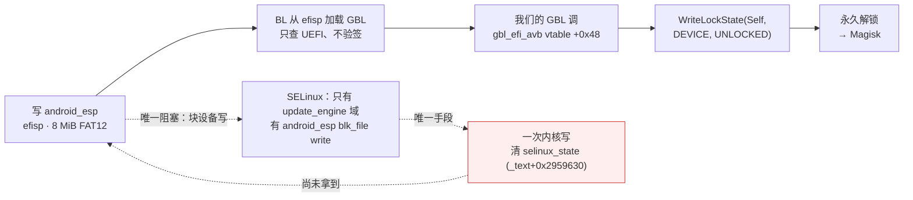
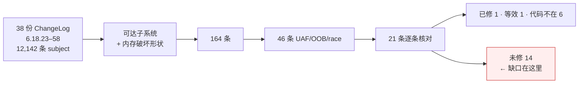

# lhasa-research — 一台 XRing O3 设备的解锁研究日志

> **TL;DR (EN)** — A reverse-engineering journal on a locked Xiaomi 18 Fold (`lhasa`, Xiaomi's own
> **XRing O3** SoC, Android 17 / HyperOS, kernel 6.18.21, SPL 2026-08-01). It documents a fully
> evidenced bootloader-unlock chain (`android_esp` → unsigned GBL load → `gbl_efi_avb.WriteLockState`),
> the last-mile blocker (one kernel write primitive), **11 ruled-out attack surfaces** with
> instruction-level evidence, an OTA → EROFS → vendor-module toolchain (486 `.ko` extracted and
> byte-verified), and a **stable patch-level audit** showing the device is missing 14 reachable
> security fixes from 6.18.45 onward. Negative results are documented as carefully as positive ones.

**快速入口**：[一页看完（SUMMARY）](docs/SUMMARY.md) · [英文版研究日志](docs/journal/EN-JOURNAL.md) · [补丁级别审计](docs/patch-level/PATCH_LEVEL_6.18.45_58.md) · [English README](README.en.md)

---

## 1. 这台机器

| 项 | 值 |
|---|---|
| 机型 | Xiaomi 18 Fold，codename `lhasa`，model 2608BPX34C |
| SoC | **XRing O3**（小米自研，非高通/联发科） |
| 系统 | Android 17 / HyperOS `OS4.0.21.0.XPNCNXM` |
| 内核 | `6.18.21-android17-5-g284297031c53-abogki553682993-4k`，SPL 2026-08-01 |
| 启动 | bootloader **locked**（AVB green，`slot-unbootable:b=yes`） |
| 攻击者身份 | `adb shell`：uid 2000、无任何 capability、Seccomp 0、SELinux Enforcing |
| 关键加固 | HARDENED_USERCOPY、FORTIFY、CFI、`BUG_ON_DATA_CORRUPTION`、`PANIC_ON_OOPS`、INIT_ON_ALLOC、PAN/MTE、`SLUB_CPU_PARTIAL`；KASAN 编了但 **cmdline `kasan=off`** |

这台机器的价值在于：它是小米**自研 SoC** 的早期机型，公开资料几乎为零，而它的启动链里有一个
"能改就能解锁"的环节。

## 2. 目标与解锁链

目标很简单：**拿 root / 永久解锁**。官方通道走不通（服务端拒绝 `flashing unlock`），所以只能从技术侧来。

整条链是这样（每一环都有实测或源码证据）：



```
① 写 android_esp（XRing 的 efisp，8 MiB FAT12，内含 EFI/BOOT/BOOTAA64.EFI 即 GBL）
        ↓
② bootloader 从 efisp 加载 GBL，只检查"是不是 UEFI 应用"、不验真实性
   （AOSP platform/bootable/libbootloader 源码 + 同族公开研究）
        ↓
③ 我们的 GBL 调 gbl_efi_avb 协议 vtable +0x48 = WriteLockState(Self, DEVICE, UNLOCKED)
   （源码证实 flashing unlock 对 LockType::Device 根本不查锁，唯一裁决者就是这个方法）
        ↓
④ 永久解锁 → 刷 Magisk → 持久 root
        ↑
   唯一阻塞：① 需要写块设备 → 需要 SELinux permissive 或 root
        ↑
   唯一可达手段：一次内核任意写（把 selinux_state 清零）
```

**这条路已经把最后一段做完了**：`payload/esp_unlock.c` 是一个 **2,560 字节**的 UEFI 应用
（`zig cc -target aarch64-uefi`，PE32+/machine 0xAA64/subsystem 10），
`tools/esp_patch.py` 能把它原地换进原厂 ESP 镜像的 `EFI/BOOT/BOOTAA64.EFI`（只改目录项 size 字段，
已逐字节验证）。也就是说：**只要拿到一次内核写，剩下的是一分钟的事。**

## 3. 卡点：一次内核写

`selinux_state` 在 `.bss`（`_text + 0x2959630`），KASLR slide 每次 boot 用
`tools/cap_pair.sh` + `tools/solve_live.py` 从 trace 原始环形缓冲解出来
（11 个符号独立算出同一个 2 MiB 对齐值，spread = 0）。

所以问题收敛成：**在 uid 2000、无 cap、SELinux Enforcing 下，怎么拿到一次内核写。**

## 4. 我们排掉了什么（11 个面，全部带证据）

| 面 | 结论 | 证据 |
|---|---|---|
| CVE-2026-64560（posix-cpu-timers 非 leader exec UAF） | **机制级不可达**：本机 de_thread 先 `exchange_tids`+`transfer_pid(TGID)` 再 `release_task`，`!sh` 窗口不存在；修正触发结构 17,600 exec 零命中 | [`docs/audits/64560_DEAD_ON_LHASA.md`](docs/audits/64560_DEAD_ON_LHASA.md) |
| HID multitouch（6.18.22 缺 report-ID 校验） | 被 core 的 `-EINVAL` 守卫吃掉 | [`HID_MT_C1_RECHECK.md`](docs/audits/HID_MT_C1_RECHECK.md) |
| uinput FF 上传/擦除 | 候选 UAF 真实，但 `/dev/input/event*` 对 shell 是 EACCES | [`UINPUT_FF_AUDIT.md`](docs/audits/UINPUT_FF_AUDIT.md) |
| `/dev/uinput` 非 FF ioctl | 无 OOB/UAF（`kstrndup(name,0x50)`、11 条 `*_MAX` 界齐全） | [`UINPUT_ASHMEM_AUDIT.md`](docs/audits/UINPUT_ASHMEM_AUDIT.md) |
| `/dev/ashmem_*` 小米变体 | 无内存破坏；但 `ignore_unset_prot_exec` 可让 uid 2000 拿到**可执行匿名内存**（实测） | 同上 |
| `tango32`（厂商 misc） | 无 OOB/UAF；`compat_ioctl` 转发实测**不改变** SELinux 判决 | [`TANGO32_AUDIT.md`](docs/audits/TANGO32_AUDIT.md) |
| `/dev/mali0`（kbase 1.9 MB） | ioctl 全 **EPERM**（allow 域不含 shell） | `probes/l71_mali.c` `l72_ioctl.c` |
| `/dev/xr_fbt` | 驱动提供者模块不在可取分区 | [`MODULE_PIPELINE.md`](docs/patch-level/MODULE_PIPELINE.md) |
| binder 页面分配器 | 真缺陷但只值 DoS（写落点常量非映射、必 panic、shrinker 放回 order-0） | [`BINDER_ALLOC_AUDIT.md`](docs/audits/BINDER_ALLOC_AUDIT.md) |
| binder 事务路径 / fd 传递 | 结构性干净（offsets 无 TOCTOU、四道界、零化栈缓冲、`failed_at` 截断；fd 无 double-close/OOB） | [`BINDER_TXN_AUDIT.md`](docs/audits/BINDER_TXN_AUDIT.md) · [`BINDER_FD_AUDIT.md`](docs/audits/BINDER_FD_AUDIT.md) |
| pty/tty（`/dev/ptmx`） | 无 UAF/OOB（环缓冲三处写点全 `and 0xfff`；ldisc 切换持写锁；`tty_struct` 是专用 cache） | [`TTY_AUDIT.md`](docs/audits/TTY_AUDIT.md) |

顺带还有一个**直接推翻前人结论**的发现：`HANDOVER_2` 里"binder 写路径要求缓冲落在自己 VMA 内"是
**测量伪影**——当年写的是裸命令字 `0x0c`，内核比的是 ioctl 编码值 `0x0000630c`。用正确编码后
`BC_TRANSACTION` 实测 `write_consumed=68`，写路径对 uid 2000 完全可达
（[`BINDER_REOPENED.md`](docs/audits/BINDER_REOPENED.md)）。

## 5. 最有价值的产出：补丁级别审计

到后期我们换了个打法：不再盲猜哪个子系统有洞，而是**拿上游稳定树的修复清单反查本机二进制**。

闭环是这样（全部可复跑）：



```
本地 38 份 ChangeLog（6.18.23–6.18.58，12,142 条 subject）
  → 按"uid 2000 可达子系统 + 内存破坏形状"筛
  → 按 subject 反查 commit sha（本地即可）
  → git.kernel.org 拉 unified diff（/patch/?id=<sha>）
  → 从 diff 提"汇编级指纹"（某个 cmp 立即数 / 新增边界分支 / 字段偏移用法）
  → 到 vmlinux-4.0.21.0.elf 里逐条核（指令地址 + 原文）
  → 三档结论：已修 / 未修 / 代码不在
```

结果（[`PATCH_LEVEL_6.18.45_58.md`](docs/patch-level/PATCH_LEVEL_6.18.45_58.md)）：

- **本机 stable 有效补丁级别 ≈ 6.18.44**（校准锚点：6.18.39 的 binder tmp_ref pin **在**、
  6.18.44 的 logitech-dj `report_count==14` 检查 **在**）；
- **6.18.45 起整段缺失**，21 条判定里 **未修 14 条 / 已修 1 条（等效）/ 代码不在 6 条**；
- 其中两条是**纯 syscall 可达的 UAF**（futex 私有 hash 的 ref 记账竞态、futex/pi 的 exec() 竞态），
  触发设计与已跑规模见 [`FUTEX_CANDIDATES.md`](docs/patch-level/FUTEX_CANDIDATES.md)。

我们还顺手排掉了整类 HID 定时器 UAF：`uhid_char_write()` 把 `UHID_DESTROY` 和 `UHID_INPUT2`
放在**同一把 `devlock`** 里，所以"报告在 remove 期间重新武装 timer"那类洞通过 uhid 根本不可达。

## 6. 负结果也是结果

- 约 **256,000 次** 竞态/相位触发（64560 的 17.6k、futex PI/exec 的 20k+20k+166k+50k），全部无崩溃；
- **538** 个 device node 全扫，只有 **14** 个对 uid 2000 可 open；
- **73** 个 misc 设备里只有 **8** 个可用（其余 ioctl 被 SELinux 或驱动自身挡住）；
- 三个"看起来能用"的通用面（userns / io_uring / bpf）全部关闭。

这些数字的意义：**这台机器在 uid 2000 上的内存破坏面确实很薄**，而这个结论是靠证据堆出来的，不是靠"试了没成功"。

## 7. 工具链（本仓库可复跑的部分）

```
tools/ota_extract.py   OTA 单分区 HTTP Range 抠取（CDN 需浏览器 UA + Referer）
tools/ota_head.py      只抓分区前 N 字节（拿 EROFS 元数据头）
tools/erofs_extract.py 完整 EROFS 读取器（legacy/compact、LZ4/ZSTD、datalayout1/3、big-pcluster、tail-packing）
tools/dump_one.py      按路径子串导出单个文件
tools/kdisasm.py       按符号反汇编厂商内核（vmlinux + Image）
tools/ko_disasm.py     ET_REL 模块按符号反汇编 + 分支标注
tools/btf_dump.py      从 Image 的 .BTF 取精确结构布局
tools/esp_patch.py     向 FAT12 ESP 镜像里换 EFI/BOOT/BOOTAA64.EFI
tools/fat_*.py         FAT12 列举/抽取/遍历
tools/solve_live.py    从 trace 原始环形缓冲解 KASLR slide（配合 cap_pair.sh）
tools/analyze_sepolicy.py  CIL 策略分析（含版本化类型名与 base_typeattr 的处理）
probes/*.c             40+ 个实机探针（可达面、ioctl 判据、竞态触发器、语义自检）
payload/esp_unlock.c   2.5 KB UEFI 载荷：调 gbl_efi_avb.write_lock_state 解锁
patches/*.patch        上游修复补丁原文（GPL-2.0，来自 kernel.org，仅作对照）
```

## 8. 仓库结构

```
docs/SUMMARY.md    一页看完：解锁链图 + 11 个面速查表 + 补丁级别漏斗 + 手上有什么
docs/journal/      交接文档与阶段报告（HANDOVER、STATUS、UNLOCK_CHAIN、KASLR_SOLVED …）
docs/journal/EN-JOURNAL.md   英文版研究日志（三轮完整叙事）
docs/audits/       11 个面的审计报告（每个结论都带指令地址/符号偏移）
docs/patch-level/  补丁级别审计、futex 候选与触发记录、模块流水线、单页状态
tools/             可复跑的分析与打包工具
probes/            实机探针源码
payload/           解锁载荷源码
patches/           上游补丁原文
```

## 9. 声明

- 所有工作在**自有设备**上完成，用户事先做过完整备份；不涉及任何第三方设备、账号或数据。
- 仓库里**不包含**任何厂商固件/模块二进制、OTAPayload、签名密钥或设备 dump；
  只保留自写源码、分析结论与**上游公开补丁**（`patches/` 为 GPL-2.0 版权，来自 kernel.org，仅作对照）。
- 这里**没有可用的利用代码**：解锁载荷依赖"先拿到一次内核写"，而这一步尚未实现；
  竞态触发器只用于验证"补丁是否缺失"，不构成 weaponized exploit。
- 目的：把一条"几乎打通"的链、以及一堆**带证据的负结果**记录下来，供同好少走弯路。
