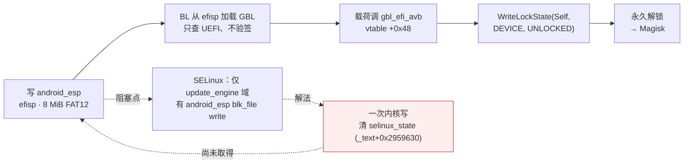
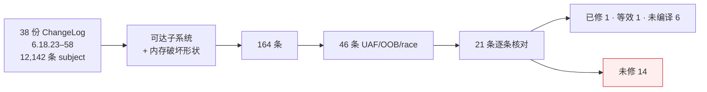

# 项目概览

本页汇总三条主线的现状：解锁链、攻击面审计、补丁级别审计。细节与证据见各分节链接。

## 1. 解锁链

链路除"内核写原语"外全部就绪：载荷 `payload/esp_unlock.c` 编译产物 2,560 字节，
`tools/esp_patch.py` 可原地替换 ESP 镜像中的 `EFI/BOOT/BOOTAA64.EFI`（逐字节验证）。

## 2. 攻击面审计

| # | 面 | 结论 | 证据 |
|---|---|---|---|
| 1 | CVE-2026-64560 | 机制级不可达（`de_thread` 顺序使 `!sh` 窗口不存在；17,600 exec 零命中） | [报告](audits/64560_DEAD_ON_LHASA.md) |
| 2 | hid-multitouch | 核心 `-EINVAL` 守卫拦截 | [报告](audits/HID_MT_C1_RECHECK.md) |
| 3 | uinput FF UAF | `/dev/input/event*` 对 shell EACCES | [报告](audits/UINPUT_FF_AUDIT.md) |
| 4 | uinput 非 FF ioctl | 无 OOB/UAF | [报告](audits/UINPUT_ASHMEM_AUDIT.md) |
| 5 | ashmem 小米变体 | 无内存破坏 | 同上 |
| 6 | tango32 | 无对象、无 OOB；compat 转发不改变 SELinux 判决 | [报告](audits/TANGO32_AUDIT.md) |
| 7 | mali0 | ioctl 全部 EPERM | [probes/l71_mali.c](../probes/l71_mali.c) |
| 8 | xr_fbt | 驱动模块不在可取分区 | [报告](patch-level/MODULE_PIPELINE.md) |
| 9 | binder 页面分配器 | 仅 DoS | [报告](audits/BINDER_ALLOC_AUDIT.md) |
| 10 | binder 事务/fd 传递 | 结构性干净 | [事务](audits/BINDER_TXN_AUDIT.md) · [fd](audits/BINDER_FD_AUDIT.md) |
| 11 | pty/tty | 环缓冲全部 `and 0xfff` 保护；tty_struct 专用 cache | [报告](audits/TTY_AUDIT.md) |

勘误：binder 写路径"必须位于自身 VMA 内"为测量伪影（裸命令字 `0x0c` vs ioctl 编码 `0x0000630c`）；
修正后 `BC_TRANSACTION` 实测 `write_consumed=68`（[BINDER_REOPENED.md](audits/BINDER_REOPENED.md)）。

## 3. 补丁级别审计

- 有效 stable 级别 **6.18.44**（锚点：6.18.39 binder tmp_ref pin、6.18.44 logitech-dj report_count 检查均存在）；
- 6.18.45 起整段缺失，无越级单独回移；
- 未修中两条为纯 syscall 可达的 UAF（futex 私有哈希 ref 计数竞态、futex/pi exec() 竞态）。

完整判定表：[PATCH_LEVEL_6.18.45_58.md](patch-level/PATCH_LEVEL_6.18.45_58.md)；
触发设计与记录：[FUTEX_CANDIDATES.md](patch-level/FUTEX_CANDIDATES.md)。

## 4. 已验证的能力

| 类别 | 内容 |
|---|---|
| 可控回收 | `/dev/uhid` + `UHID_CREATE2` → order-1 kmalloc-256（内容全控）；`send(AF_UNIX, 11872)` → order-1 整页 8192 B 全控；`UI_SET_PHYS` → kmalloc-1k |
| 布局稳定 | `tango32` 命令 `0x74a2` 可将 `mm->mmap_base` 设为 `[0x10000001, 2^39)` 内任意值 |
| 执行内存 | ashmem `ignore_unset_prot_exec` → `mmap(PROT_READ\|PROT_EXEC)`（实测） |
| 地址信息 | KASLR slide 每 boot 可解（`tools/cap_pair.sh` + `tools/solve_live.py`）；`selinux_state = _text + 0x2959630` |
| 解锁载荷 | 2,560 B UEFI 应用 + ESP 打包工具 |

## 5. 现状与限制

futex PI/exec 系列触发器共运行 256,000 次迭代（20,000 + 20,000 + 166,000 + 50,000），64560 触发器运行 17,600 次 exec，均无可观察效果。设备 `kasan=off`、内核日志不可读、`panic_on_warn=0`，盲触发条件下 UAF 无法从外部确认；两条 futex UAF 的对象分别为 `mm_struct`（专用 cache `mm_cachep`）与 `kvzalloc` 哈希数组，后者尺寸可控、可被现有回收原语覆盖，是目前唯一仍具利用前景的方向，分析见 [FUTEX_CANDIDATES.md](patch-level/FUTEX_CANDIDATES.md) §5.2。
