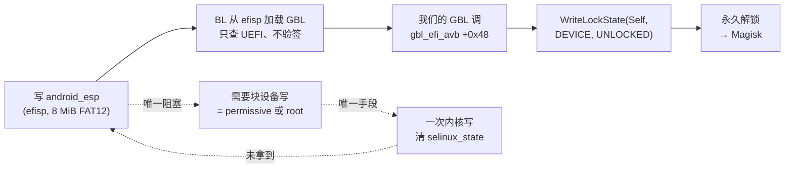
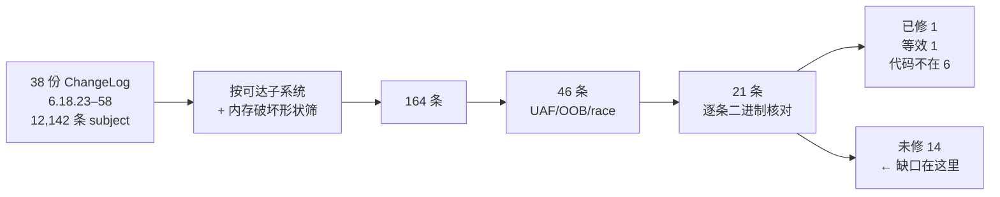

# 一页看完（Summary）

> 这台机器上"为什么还没拿到 root"，以及我们已经用证据关掉了什么。

## 1. 解锁链（已打通到最后一步）

**成品已经造好**：`payload/esp_unlock.c` → 2,560 字节 UEFI 应用（PE32+/0xAA64/subsystem 10），
`tools/esp_patch.py` 可原地替换原厂 ESP 里的 `EFI/BOOT/BOOTAA64.EFI`（只改目录项 size，已逐字节验证）。

## 2. 排掉的 11 个面

| # | 面 | 判定 | 一句话原因 | 证据 |
|---|---|---|---|---|
| 1 | CVE-2026-64560（posix-cpu-timers 非 leader exec UAF） | **机制级不可达** | 本机 `de_thread` 先 `exchange_tids`+`transfer_pid(TGID)` 再 `release_task`，`!sh` 窗口不存在；修正触发结构 17,600 exec 零命中 | [`64560_DEAD_ON_LHASA.md`](audits/64560_DEAD_ON_LHASA.md) |
| 2 | HID multitouch（6.18.22 缺 report-ID 校验） | 已封 | core 侧 `-EINVAL` 守卫挡住，只到 `dev_warn` | [`HID_MT_C1_RECHECK.md`](audits/HID_MT_C1_RECHECK.md) |
| 3 | uinput FF 上传/擦除 UAF | 不可达 | `/dev/input/event*` 对 shell 是 EACCES | [`UINPUT_FF_AUDIT.md`](audits/UINPUT_FF_AUDIT.md) |
| 4 | `/dev/uinput` 非 FF ioctl | 干净 | `kstrndup(name,0x50)` 强制 NUL；11 条 `*_MAX` 界齐全 | [`UINPUT_ASHMEM_AUDIT.md`](audits/UINPUT_ASHMEM_AUDIT.md) |
| 5 | `/dev/ashmem_*` 小米变体 | 干净（但留了个能力） | 无内存破坏；`ignore_unset_prot_exec` 实测可让 uid 2000 拿到**可执行匿名内存** | 同上 |
| 6 | `tango32` 厂商 misc | 干净 | fops 只挂 `unlocked_ioctl`、无对象；`compat_ioctl` 转发实测**不改变** SELinux 判决 | [`TANGO32_AUDIT.md`](audits/TANGO32_AUDIT.md) |
| 7 | `/dev/mali0`（kbase 1.9 MB） | 不可达 | ioctl 全 **EPERM**（allow 域不含 shell） | `probes/l71_mali.c` `l72_ioctl.c` |
| 8 | `/dev/xr_fbt` | 不可达 | 驱动提供者模块不在可取分区（`os_cpu_qi.ko` 只是 import） | [`MODULE_PIPELINE.md`](patch-level/MODULE_PIPELINE.md) |
| 9 | binder 页面分配器（全局 freelist） | 仅 DoS | 写落点常量非映射、命中必 panic、shrinker 放回 order-0 | [`BINDER_ALLOC_AUDIT.md`](audits/BINDER_ALLOC_AUDIT.md) |
| 10 | binder 事务路径 + fd 传递 | 干净 | offsets 无 TOCTOU、四道界、零化栈缓冲、`failed_at` 截断；fd 无 double-close/OOB | [`BINDER_TXN_AUDIT.md`](audits/BINDER_TXN_AUDIT.md) · [`BINDER_FD_AUDIT.md`](audits/BINDER_FD_AUDIT.md) |
| 11 | pty/tty（`/dev/ptmx`） | 干净 | 环缓冲三处写点全 `and 0xfff`；ldisc 切换持写锁；`tty_struct` 是专用 cache | [`TTY_AUDIT.md`](audits/TTY_AUDIT.md) |

另外**推翻了一条前人结论**：`HANDOVER_2` 里"binder 写路径要求缓冲落在自己 VMA 内"是**测量伪影**
（当年写了裸命令字 `0x0c`，内核比的是 ioctl 编码值 `0x0000630c`）。用正确编码后
`BC_TRANSACTION` 实测 `write_consumed=68` —— 写路径对 uid 2000 完全可达
（[`BINDER_REOPENED.md`](audits/BINDER_REOPENED.md)）。

## 3. 补丁级别审计（目前最有价值的产出）

- **有效稳定版级别 ≈ 6.18.44**；6.18.45 起整段缺失、无越级单独回移；
- 校准锚点：6.18.39 的 binder `tmp_ref` pin **在**（`0x1c5b8c` + `0x1c5ba8 stadd`）、
  6.18.44 的 logitech-dj `report_count==14` **在**（`0xf7fb80 cmp w3,#0xe`）；
- 未修里两条是**纯 syscall 可达的 UAF**：futex 私有 hash 的 ref 记账竞态、futex/pi 的 `exec()` 竞态
  （[`PATCH_LEVEL_6.18.45_58.md`](patch-level/PATCH_LEVEL_6.18.45_58.md) ·
  [`FUTEX_CANDIDATES.md`](patch-level/FUTEX_CANDIDATES.md)）。

## 4. 手上有什么

| 类别 | 内容 |
|---|---|
| 可控回收 | `/dev/uhid`+`UHID_CREATE2` → order-1 **kmalloc-256**（32 对象/8K，内容全控）；`send(AF_UNIX,11872)` → **order-1 整页 8192 B 全控**；`UI_SET_PHYS` → kmalloc-1k |
| 布局稳定 | `tango32` 命令 `0x74a2` 可把 `mm->mmap_base` 改到 `[0x10000001, 2^39)` 任意值 ⇒ mmap ASLR 归零 |
| 执行内存 | ashmem `ignore_unset_prot_exec` → 可 `mmap(PROT_READ\|PROT_EXEC)`（实测） |
| 地址信息 | KASLR slide 每 boot 可解（`cap_pair.sh` + `solve_live.py`，11 符号 spread=0）；`selinux_state = _text + 0x2959630` |
| 解锁载荷 | 2,560 B EFI + ESP 打包工具（见 §1） |

## 5. 为什么停在这里

- 约 **256,000 次**竞态/相位触发（64560：17.6k；futex PI/exec：20k+20k+166k+50k）**全部无崩溃**；
- 设备**没有可观测量**：`kasan=off`、`dmesg`/`tainted`/`pstore` 读不到、`panic_on_warn=0`
  ⇒ UAF 静默，唯一信号是 panic；
- 两条 futex UAF 的对象分别是 `mm_struct`（**专用 cache `mm_cachep`**）与 `kvzalloc` 的 hash 数组；
前者现有回收原语打不中，后者是唯一还值得继续的方向（见 `FUTEX_CANDIDATES.md` §5.2）。

## 6. 工具链 / 复现

`tools/ota_extract.py` → `tools/erofs_extract.py` → `tools/dump_one.py`（OTA→EROFS→单个 `.ko`）；
`tools/kdisasm.py` / `tools/ko_disasm.py` / `tools/btf_dump.py`（内核与模块逆向）；
`tools/esp_patch.py`（ESP 打包）；`tools/solve_live.py` + `tools/cap_pair.sh`（KASLR）；
`probes/*.c`（40+ 个实机探针）。
